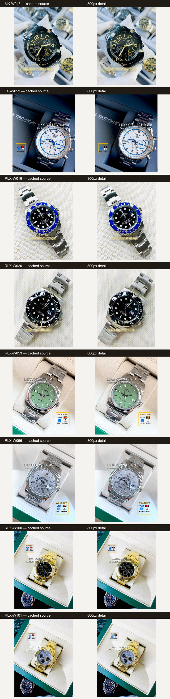

# Product image quality review

Eight cached workbook originals appear on the left; their optimized 800px details appear on the right. The contact sheet was generated entirely from local files. At the displayed 360px review size, the sampled watch-dial lettering, metal edges, highlights, and color remain visually comparable. This sample does not establish quality for every image, so automated checks also verify every image decodes, stays within size bounds, preserves alpha, and has a content-derived filename.

